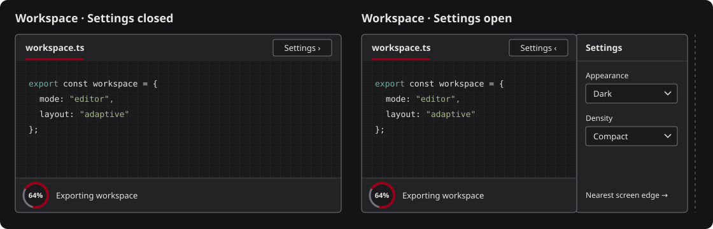
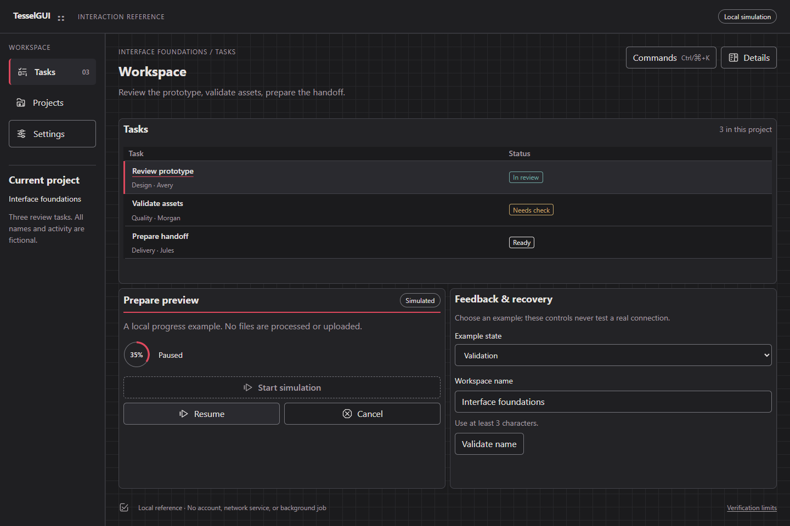

# TesselGUI

TesselGUI is a design standard for dense desktop interfaces. It pairs near-black charcoal surfaces and a deep red accent with a task-sized workspace, contextual drawers, and radial progress.

[Master Specification & AI Implementation Prompt](docs/master-specification.md) · [Design mockup](assets/mockups/tessel-master-spec.svg) · Docs [CC BY 4.0](LICENSE) · Code and tokens [MIT](LICENSE-CODE)

> [!NOTE]
> Tessel is for engineers and designers building desktop-class editors,
> data tools, media tools, monitors, utilities, communication apps, CAD tools
> and system settings. It specifies the tokens, regions, density and behavior
> needed for long sessions in high-density interfaces.

**Contents** · [Design standard](#design-standard) · [Reference demos](#reference-demos) · [Any category](#any-category) · [Adopt Tessel](#adopt-tessel)

## Design standard

Use a High Contrast VS Code baseline with a bespoke deep red accent. Give the active task the space it needs and let supporting modules fill the viewport along balanced alignment axes. Keep secondary tools in drawers that open toward the nearest usable screen edge. Use a fine grid in empty areas, tokenized surface levels, compact type, and radial progress with a visible percentage when known.

## Reference demos

The live workspace and current token exports demonstrate the design standard. The static gallery illustrates earlier designs. [Live demo](https://seanshaffer88.github.io/TesselGUI/demo/) · [Contrast checker](https://seanshaffer88.github.io/TesselGUI/demo/contrast/) · [Token exports](dist/) · [Validation status](https://github.com/SeanShaffer88/TesselGUI/actions/workflows/validate.yml)

  

*Dark-theme screenshot of the running reference workspace.*

## Any category

  

*Revision 3 screenshot of the category gallery.* The examples cover data and records, editors, media, monitoring, wizards, communication, CAD, and system tools. [Category demo](https://seanshaffer88.github.io/TesselGUI/demo/categories/) · [Category layout archive](docs/categories.md)

## Applied to different programs

  

*Slideshow of the Revision 3 mockups below, 3 seconds each. Click any entry to open its full-size image. All programs, names and data are fictional.*

| Program type | What the design does | Mockup |
| --- | --- | --- |
| Spreadsheet | Dominant grid with row and column gridlines, frozen headers, tabular figures, formula bar, one accent Save | [View](assets/mockups/tessel-spreadsheet.png) |
| File and folder compare | Two synchronized panes, a state list, a differences table, markers that do not rely on color alone, one accent Merge | [View](assets/mockups/tessel-file-compare.png) |
| Music production | Browser, arrangement with clips, mixer with segmented meters, value controls, one accent Record | [View](assets/mockups/tessel-music-production.png) |
| Image editor | Neutral viewport around the canvas, tool rail, layers, adjustments, history, one accent Export | [View](assets/mockups/tessel-image-editor.png) |
| Video editor | Media bin, preview, inspector, multi-track timeline with a playhead, one accent Export | [View](assets/mockups/tessel-video-editor.png) |
| Code editor | Explorer, editor, symbols, problems table and terminal, status with icon and text, one accent Run | [View](assets/mockups/tessel-code-editor.png) |
| Program manager | Gridded list of installed programs, filters, details, one accent Uninstall | [View](assets/mockups/tessel-program-manager.png) |
| Monitoring console | Metric tiles, a chart with a table alternative, events, a node table, one accent Acknowledge | [View](assets/mockups/tessel-monitoring.png) |

Every mockup follows the same rules: regions fill their space, data lists are gridded, one accent element per region, edges for structure, a single active-region rule per window.

### Light theme

  

*The same eight programs in the light theme, 3 seconds each. Full-size images are in [assets/mockups/light](assets/mockups/light/).*

### Graphite preset for color-critical work

Image and video tools use the Graphite preset so no tinted chrome sits next to the work. The primary action, selection marker and focus ring are neutral, and the viewport surround stays neutral gray.

| Image editor | Video editor |
| --- | --- |
|  |  |

## Creative and multi-mode tools

The earlier detailed reference covers modes, panels, value controls, timelines and meters. Read it alongside the current standard. [Workspace patterns](docs/workspaces.md) · [Revision 3 reference index](docs/design-guidelines.md)

## Accessibility

Tessel targets [WCAG 2.2 AA](https://www.w3.org/TR/WCAG22/), including 4.5:1
contrast for normal text. The 44 × 44 CSS px touch policy is separate from AA's
24 × 24 target-size criterion. Consult the [verification record](docs/verification.md)
for the checks run and their limits. Static images and unit tests do not replace
keyboard, screen-reader and reduced-motion testing in your application.

## Adopt Tessel

- Apply the master specification and verify layout and keyboard behavior in the target application. [Adoption guide](docs/adoption.md) · [Verification guide](docs/verification.md)
- Choose the token export for your stack. [CSS](demo/tokens.css) · [Source JSON](docs/tokens.json) · [Native exports](dist/) · [npm source package](packages/npm/) · [Rust source package](packages/rust/) · [Migration notes](docs/migration.md)
- Try the PortableForge workflow or run the references locally. [PortableForge demo](https://seanshaffer88.github.io/TesselGUI/demo/portableforge/) · [Local setup](demo/README.md)
- Consult the archived Revision 3 guidelines for earlier examples and rules. [Revision 3 quick reference](docs/quick-reference.md) · [Design guidelines](docs/design-guidelines.md)
- [Audit](AUDIT.md) · [Contributing](CONTRIBUTING.md) · [Credits](CREDITS.md) · [Attribution](ATTRIBUTION.md)

For the maintainer's projects, plan adoption for the next scheduled release and
show project-specific mockups for review before implementation.
