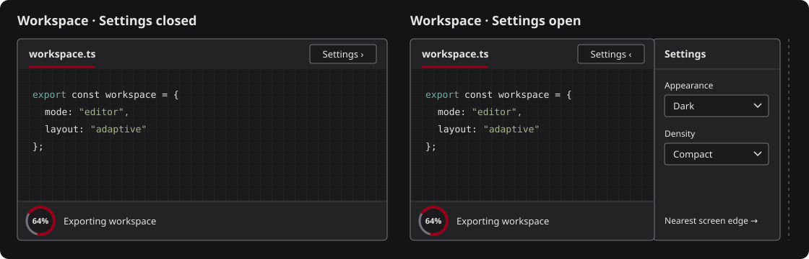

# TesselGUI Master Specification & AI Implementation Prompt

**Revision 4 · Current design standard**

Apply the requirements below when implementing Revision 4. They take precedence over conflicting Revision 3 guidance, including percentage-based pane widths, asymmetrical alignment as the default, and segmented progress. The published demos, token exports, and detailed reference guides describe Revision 3. [Revision 3 design guidelines](design-guidelines.md)

## 1. Core Identity & Aesthetic

- **Theme baseline.** Use VS Code's High Contrast design as the baseline and replace its standard accent slots with a custom deep red palette.
- **Surface palette.** Use near-black charcoal for structural contrast. The editor background is `#1B1B1D` and the panel surface is `#232326`.
- **Accent palette.** Tune the deep red for primary actions, keyboard focus, and active regions. Pair accent color with a distinct cue such as an outline, a marker, a label, or an exposed control state.

## 2. Structural & Layout Protocols

- **Dominant focal point.** Size the primary workspace around the active task, the content's minimum sizes, and the available viewport. Let it grow and reflow as the task changes without fixed percentage allocations.
- **Adaptive contextual drawers.** Present secondary windows, settings, and configuration as drawers. Choose the nearest usable screen edge based on the main window's placement and slide the drawer out from behind the window toward that edge. Keep the drawer within the available work area. Use an in-window edge drawer when there is insufficient room beside the window. Respect reduced motion.
- **High information density and grid.** Assign available space to functional regions. Secondary modules expand to fill their available viewport space. Use a fine square grid to anchor empty areas and keep dense content legible.
- **Symmetrical alignment.** Align core elements to shared axes and use balanced spacing on corresponding edges. Keep alignment consistent as regions resize independently.

## 3. UI Component Behaviors & Micro-Interactions

- **Radial progress.** Use a circular completion graphic for time-based operations and progress metrics. Show a visible percentage and expose the operation name and value to assistive technology when completion is measurable. Use an indeterminate ring and a descriptive status when the percentage is unknown. Honor reduced motion and provide an explicit final state.
- **Progressive disclosure.** Keep secondary tools, options, and configuration toggles in contextual drawers that start closed. Provide visible, predictable triggers with a keyboard path and an expanded state. Return focus to the trigger when its drawer closes.

## 4. Semantic Token & Surface Mapping

- **Elevation protocol.** Assign surfaces to semantic elevation tokens. Distinguish layers through surface fills and edges, with a flat visual treatment and no drop shadows.
- **Typography and rhythm.** Use a proportional type scale and compact line heights. Apply shared vertical alignment across dense data containers and let the layout reflow at increased text sizes.

## Reference mockup

The static mockup illustrates the layout and uses fictional data. Check edge selection, resizing, focus restoration, and determinate and indeterminate progress in the target application. [Verification guide](verification.md)
